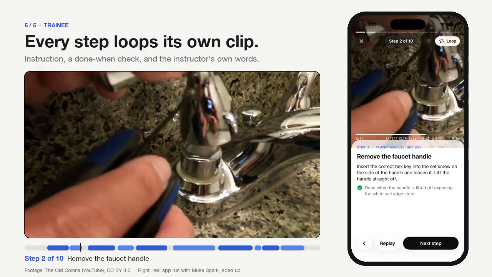
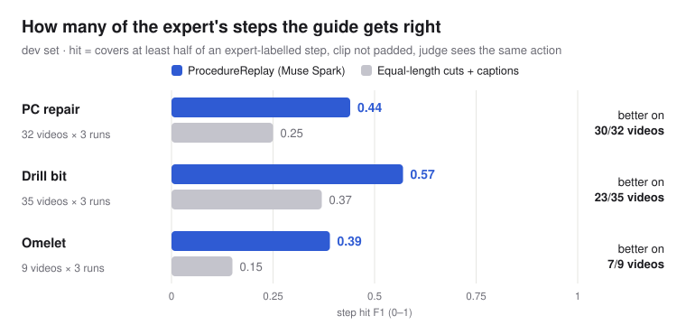

# ProcedureReplay

**Wear Meta glasses, do the job and talk it through: Muse Spark turns that one recording into a step-by-step
video guide that anyone can follow on their phone.**

<!-- Hero: docs/assets/hero.mp4, built by scripts/make_readme_hero.py -->
<a href="docs/assets/hero.mp4"></a>

<sub>A real run: a 78-second first-person recording becomes a 10-step guide (Muse Spark, about $0.007). Phone screen sped up per phase.
Footage: [The Old Corona](https://www.youtube.com/watch?v=LPwPomA7BfM), CC BY 3.0.</sub>

Meta's multimodal model (Muse Spark, with Muse Voice Transcribe for the narration) splits the recording into
steps and writes, for each step, an instruction, a "done when" check and the instructor's own words; the server
cuts one looping clip per step. The instructor reviews the draft, publishes it as public or private, and public
guides appear in a feed where people can like and save them. The same app covers factory work (repairing a PC,
changing a drill bit) and everyday tasks (cooking, fixing a faucet).

An earlier part of the project, still in this repo, checks a trainee's own video against a guide and flags
**skipped** or **out-of-order** steps (Trainee review pipeline below).

Built for the Meta Global AI Developer Hackathon (indie track, "Push the Frontier", manufacturing),
Oct 26 – Nov 4, 2026.

## Guide builder and its evaluation

`pr.build` turns one video into a guide (contract v1) with a single Muse Spark 1.3 call. The app's recordings
and the evaluation go through the same function. It sees only the video (5 fps proxy with a burned-in clock,
muted unless the config turns audio on), its duration, the narration's transcript turns (Muse Voice
Transcribe), the category list and the instructor's "Mark step" times. Nothing derived from the labels goes in:
no step count, task name, keysteps or object list. Post-processing sorts the steps, clamps and pads the clips,
cuts overlaps and drops quotes that aren't in the transcript; the raw answer is kept.

`scripts/run_guides.py` scores the guides against the datasets' step labels (plan: [docs/B0_guide_eval_plan.md](docs/B0_guide_eval_plan.md)):

- **Step hit F1.** Muse Spark judges each predicted step against its candidate labels (same action?), and
  pairs are matched one to one. Also reported: a judge-free temporal IoU F1, boundaries, clip focus, a
  4-question rubric per step, category accuracy.
- **Baselines.** "Uniform + captions" cuts the video into equal parts, one per labelled step.
- **Splits** (`config/splits.yaml`): `iterate` for changes, `dev` to compare configurations, `test` once with
  the frozen configuration (`--i-am-at-b4`).

Dev set (76 videos × 3 runs, config `tr-ost-mute`, about $4.4 of API calls), step hit F1 pooled per domain:



| Domain | Videos | Guide builder | Uniform + captions | Videos where the builder wins | Temporal IoU F1 (builder / uniform) |
| --- | --- | --- | --- | --- | --- |
| PC repair | 32 | 0.44 | 0.25 | 30/32 | 0.74 / 0.66 |
| Drill bit | 35 | 0.57 | 0.37 | 23/35 | 0.76 / 0.66 |
| Omelet | 9 | 0.39 | 0.15 | 7/9 | 0.62 / 0.49 |

The judge is the builder's own model, so `scripts/judge_check.py` draws 30 items for a blind human check. Every
one of the 15 disagreements was the judge saying No where the human said Yes. That suggests the scores above
are, if anything, too low. "Same action" and "done when is observable" disagree 15% or more in every domain,
so those two scores need more human review before they can be trusted alone. `scripts/compare_configs.py`
compares configurations from stored results (paired per video, sign test, bootstrap interval). In the first
round, dropping the on-screen-text instruction made no difference; turning the audio on helped PC repair by
+0.05 F1 and didn't help the other two. No configuration is frozen yet, and the test set hasn't been opened.

## Trainee review pipeline (earlier part)

```
expert's step names ─┐
reference video ─► license gate ─► 5 fps proxy ─► Muse Spark 1.3 ─► checklist: steps, "done when", times
trainee video   ─► license gate ─► 5 fps proxy ─► Muse Spark 1.3 (whole checklist, then each "not done"
                                                  step again on its own) ─► per step: done? when? evidence
                                                ─► judge (order rules) ─► ok / missing / out_of_order
evaluation: edited videos with a known injected flaw (cut or swap) ─► detected X/6, false flags Y/2
```

- **Muse Spark 1.3** (Meta Model API, Responses API + JSON-schema structured output) writes the checklist
  from the reference video and decides, for the trainee video, which steps were done and when.
- The review sends the trainee video **without its sound**. Meta's docs say audio understanding in Muse Spark 1.3
  is not fully supported, and on the dev set the muted review found more flaws (5.3 vs 4.0 of 9, mean of 3 runs)
  with no more false flags. Muse Voice Transcribe found no speech in the dataset videos, so there was no
  narration to add ([results/summary_dev_audio.md](results/summary_dev_audio.md)).
- **SAM 3.1** (Meta Model API) is *not* part of the decision: smoke tests showed it can't see small parts
  (RAM, coin battery) on 480p glasses footage. It is used for evidence visuals (object masks) only.
- Videos are re-encoded to a 5 fps 720p proxy with a burned-in clock, so frame index ↔ seconds is exact
  for both models and SAM's per-frame cost stays low.

Success criterion: detect the injected flaw in ≥5 of 6 edited videos, with 0 false flags on 2 unedited videos.

## Setup

Requires Python 3.11+, [uv](https://docs.astral.sh/uv/), and ffmpeg (`brew install ffmpeg`).

```bash
uv sync
cp .env.example .env          # then put your Meta Model API key in META_API_KEY
uv run python -m pr.license_check
```

## iPhone app

SwiftUI, iOS 26 (Liquid Glass), with the [Meta Wearables Device Access Toolkit](https://github.com/facebook/meta-wearables-dat-ios)
1.0.1. The app talks to the Mac server (`src/pr/server.py`), so the Meta API key never leaves the Mac.

What plays the glasses (Settings, gear on Record):

- **iPhone camera + mic** (default on a device). The iPhone, worn on the head or chest, stands in for the
  glasses. Its microphone records the instructor and runs on-device speech recognition for the live caption.
  The server merges that track into the glasses video before building the guide.
- **Demo video** (default in the simulator). **MockDeviceKit** plays a licensed video as the glasses' camera
  feed, and the demo says so.

Settings also holds the server URL (with a connection test) and the creator name credited on recordings.

| Screen | What it does |
| --- | --- |
| Record | The glasses' view, REC time, live narration caption, "Mark step" (or a tap on the glasses); stopping uploads the recording |
| Building | The server job's stages: upload → transcribe → read on-screen text → split into steps → write instructions |
| Draft | Meta AI's title, summary and steps; the instructor edits a step's words or re-cuts its start/end |
| Publish | Title, category and description arrive filled in ("AI suggested"); Public or Private |
| Feed | Public guides, newest first, by category; like and save |
| Guide · Step player | A trainee's view: each step's clip loops with its instruction, "done when" and the instructor's quote |
| Lens mode | Sends the current step to Meta Ray-Ban Display glasses: "Step n of N", instruction, "done when", Back / Next / Replay; the trainee can also say "next", "back" or "replay" |
| Library | Continue where you stopped, saved guides, your own guides and who can see them |

Glasses speech (MWDATSpeech) and inputs (MWDATInputs) are experimental DAT capabilities. Recording and the
lens buttons work without them. Without hardware, MockDeviceKit pairs simulated Display glasses, and the step
player draws their lens in the corner as "Simulated lens".

In demo-video mode, MockDeviceKit sends video only, so the app's own capture is silent. The app records which stretch of the feed
video played while it recorded, and the server stores that stretch of the licensed source, with its sound, as
the recording (`simulated_capture` in `src/pr/server.py`). The guide is then built from the recording as it
would be from real glasses. It also plays the feed video's transcript through the mock speech recognizer
(`GET /sources/{video_id}/transcript`), labelled "glasses speech, simulated".

Run it:

```bash
scripts/make_mock_feed.sh yt_LPwPomA7BfM    # the glasses feed: a narrated first-person video (HEVC, 540x960, 30 fps)
uv run python scripts/seed_guides.py        # optional: three demo guides in the feed
uv run uvicorn pr.server:app --port 8000    # Muse Spark builds guides; PR_BUILDER=checklist for an offline stand-in
cd ios && xcodegen && open ProcedureReplay.xcodeproj   # then run on an iOS 26 simulator
```

Launch arguments for unattended checks, each writing a JSON result into the app's Documents folder:
`--autorun-a3` (record → Draft), `--autorun-a5` (… → publish), `--autorun-e2e` (… → open from the Feed → play →
Library; `PR_AUTORUN_RECORD_S` sets the recording length), `--autorun-lens` (lens mode, Next on the lens and
by voice), `--open-guide=<id>`, `--open-draft=<id>`. `PR_SERVER` and `PR_FEED` (`phoneCamera` / `demoVideo`)
override Settings.

On an iPhone: run the server with `--host 0.0.0.0` and put the Mac's address (`http://<mac-ip>:8000`) in Settings.

## Data

Two first-person scenarios, so the same pipeline covers a factory floor and a home kitchen:

| Scenario | Dataset | Camera | License | Tasks (`config/tasks.yaml`) |
| --- | --- | --- | --- | --- |
| Factory | [IndEgo](https://huggingface.co/datasets/FraunhoferIPK/IndEgo) (Fraunhofer IPK, NeurIPS 2025) | Project Aria glasses | CC BY 4.0 | `pc_repair` (Task 22, 9 steps), `drill_bit` (Task 7, 5 steps) |
| Home | [CaptainCook4D](https://captaincook4d.github.io/captain-cook/) (UT Dallas, NeurIPS 2024) | head-mounted GoPro | Apache-2.0 | `home_cooking` (herb omelet with fried tomatoes, 15 steps) |

Both come with human step labels and real mistake takes. IndEgo takes are correct (`_c_`) or mistake (`_m_`);
CaptainCook4D takes are normal or error. Recipes are partial orders (you can chop the cilantro before or after
taking the tomato), so `import_captaincook.py` also writes the recipe graph to `data/task_graphs/`, and
`inject.py swap` refuses to swap two steps the recipe allows in either order.

Videos never go in git. Download only the 480p videos and annotations (~0.9 GB; the full dataset is ~19 TB):

```bash
uvx --from huggingface_hub hf download FraunhoferIPK/IndEgo --repo-type dataset --local-dir data/raw/indego \
  --include "Mistake_Detection/Task_22/mp4_480/*" \
  --include "Mistake_Detection/Task_22/annotations/keystep_annotations/*" \
  --include "Mistake_Detection/Task_7/mp4_480/*" \
  --include "Mistake_Detection/Task_7/annotations/keystep_annotations/*" \
  --include "Mistake_Detection/renamed_annotation_mistakes/A_Task_22.txt" \
  --include "Mistake_Detection/renamed_annotation_mistakes/A_Task_07.txt"
uv run python scripts/import_indego.py --drop-examples   # manifest, ATTRIBUTION, data/keysteps/, real-mistake labels
```

CaptainCook4D: clone the two small repos (labels + download links), print the curl lines for the 17 omelet
recordings (GoPro 360p, ~80 MB each), run them, then import:

```bash
git clone --depth 1 https://github.com/CaptainCook4D/annotations data/raw/captaincook4d/annotations
git clone --depth 1 https://github.com/CaptainCook4D/downloader  data/raw/captaincook4d/downloader
uv run python scripts/import_captaincook.py --print-downloads > /tmp/cc4d_download.sh   # review, then: sh /tmp/cc4d_download.sh
uv run python scripts/import_captaincook.py   # manifest, ATTRIBUTION, data/keysteps/, data/task_graphs/, real-error labels
```

Every video is listed in `data/manifest.csv` (video_id, task, creator, source_url, license, role, local_path) and
`ATTRIBUTION.md`. Every script refuses a video whose manifest row lacks an allowed license (CC0, CC-BY, CC-BY-SA,
Pexels, Pixabay, Apache-2.0; never ND or NC). Why that list: [docs/HACKATHON_RULES.md](docs/HACKATHON_RULES.md).

`data/ground_truth.jsonl` has one row per trainee video. `injected_flaw.type` is `none`, `cut`, or `swap`;
`steps` are 1-based step numbers from `step_list`; `start_ts`/`end_ts` are seconds in the **edited** video
(for a cut, both equal the splice point; for a swap, the span where the moved block now sits).

## Run

```bash
# smoke tests (each prints PASS/FAIL with evidence)
uv run python scripts/smoke_sam.py data/raw/<video>.mp4 --task pc_repair
uv run python scripts/smoke_steps.py data/raw/<reference>.mp4 --task pc_repair
uv run python scripts/smoke_cross_creator.py data/raw/<a>.mp4 data/raw/<b>.mp4 --task pc_repair

# inject a known flaw into a trainee video (ranges come from IndEgo's keystep labels)
uv run python -m pr.inject cut  --video 22_u14_r03_c_01 --step "add ram"
uv run python -m pr.inject swap --video 22_u15_r03_c_01 --step-a "add battery" --step-b "attach fan"
uv run python -m pr.inject none --video 22_u16_r03_c_01

# full evaluation (--dry-run: cached results only, no API calls)
uv run python scripts/run_eval.py               # held-out test set: data/ground_truth.jsonl
uv run python scripts/run_eval.py --set dev     # dev set: data/ground_truth_dev.jsonl
uv run python scripts/run_eval.py --set dev --runs 1,2,3   # 3 independent reviews per video + majority vote
uv run python scripts/run_eval.py --set dev --with-audio      # experiment: review with the sound (old default)
uv run python tests/test_score.py && uv run python tests/test_judge.py && uv run python tests/test_vote.py

# guide builder evaluation (results/guide_runs/, summary in results/summary_guides_<set>.md)
uv run python scripts/run_guides.py --set iterate               # a round of changes
uv run python scripts/run_guides.py --set dev --runs 1,2,3      # compare configurations
uv run python scripts/run_guides.py --set iterate --dry-run     # score cached results only, no API calls
uv run python scripts/compare_configs.py --set iterate --ref tr-ost-mute tr-noost-mute tr-ost-audio
uv run python scripts/judge_check.py draw                       # blind human check of the judge
for t in tests/test_build.py tests/test_contract.py tests/test_guide_eval.py tests/test_guides_api.py \
         tests/test_simulated_capture.py tests/test_mic_audio.py; do uv run python $t; done
```

**Dev / test split.** Prompts and pipeline changes are tuned on the dev set only: flaws injected into
*other* takes (`uv run python -m pr.inject --set dev ...`). The held-out test set (6 flaws + 2 clean videos)
is re-scored only to report results. Videos of both sets and their source takes are excluded from
learning order rules.

Every API call is logged with tokens/frames and estimated cost to `results/costs.csv`.

## What the evaluation does and doesn't show

- **Scope.** The expert gives the step *names* (the dataset's keystep labels); Muse Spark writes each step's
  description, "done when" and timing from the reference video, then reviews trainee videos. This tests
  "Guide from an expert's step list + review of other people", not discovering a procedure from video alone.
- **Scoring.** A cut counts as detected if the cut step is flagged missing (no time check: a step that never
  happens has no place in the video, and PC parts go in any order). A swap needs an out-of-order flag on a
  swapped step within ±5 s of the moved span. Wrong flags raised next to the right one are reported as
  "extra flags on flawed videos".
- **Size.** 3 tasks, 6 injected flaws + 2 clean videos in the test set, taken from overlapping people and
  takes. Even treated as independent, 3/6 has a 95% Wilson interval of about 19–81%. Results are
  exploratory, not a general accuracy figure.

Test-set history (held-out; each line is a different pipeline):

| Pipeline | Detected | False flags | Note |
| --- | --- | --- | --- |
| v1: Muse Spark splits the reference itself, steps mapped by time overlap | 4/6 | 0/2 | first eval |
| v2: checklist from expert step names, purpose-based review, re-check (tuned on dev) | 3/6 | 1/2 | |

Known reasons for the v2 test misses, found after scoring and **not** used to change the test set:
the fan and drill-bit cuts were made before cuts were padded, so part of the action is left in the video;
the omelet swap was read in checklist order instead of from the clock (the same video was detected by v1);
the false flag is "test the PC" on a correct take whose monitor stays black to the end, while the Guide's
"done when" asks for a boot screen (seen in the reference). That last one is what an expert's edit of the
Guide is for.

## Built during the hackathon

All code in this repository was written Oct 26 – Nov 4, 2026, starting from an empty repo.

| Component | What it does | Status |
| --- | --- | --- |
| `src/pr/license_check.py` | Manifest access + license gate (CC0/CC-BY/CC-BY-SA/Pexels/Pixabay/Apache-2.0 only) | day 1 |
| `src/pr/client.py` | Meta Model API wrapper: file upload, SAM 3.1 streaming, Muse Spark structured output, retries, cost log | day 1 |
| `src/pr/frames.py` | ffprobe, 5 fps proxy with burned-in clock, trimming, frame grabs | day 1 |
| `src/pr/track.py` | SAM output → per-object presence timeline | day 1 |
| `src/pr/steps.py` | Muse Spark → checklist JSON (from the expert's step names) with timestamps, "done when", reference frames | day 1–2 |
| `src/pr/inject.py` | ffmpeg cut / swap flaw injection by keystep name (cuts padded ±3 s), dev/test ground truth + attribution logging; refuses swaps a recipe allows | day 1–2 |
| `scripts/import_indego.py` | Registers downloaded IndEgo videos: manifest, attribution, keystep labels, real-mistake labels | day 1 |
| `scripts/import_captaincook.py` | Prints CaptainCook4D download commands; registers videos, step labels, recipe graph, real-error labels | day 1 |
| `src/pr/align.py` | Muse Spark reviews a trainee video against the reference checklist (done? when?, judged by purpose), re-checks each "not done" step on its own, asks again for steps it skipped; independent runs + per-step vote | day 1–2 |
| `src/pr/judge.py`, `src/pr/order.py` | Missing / out-of-order flags; order rules from the recipe graph or learned from correct takes | day 1 |
| `scripts/smoke_*.py` | API smoke tests | day 1 |
| `src/pr/score.py`, `tests/test_*.py` | Scoring rule (detected / false flag / extra flags) + checks for scoring, judging, voting | day 1–2 |
| `scripts/run_eval.py` | Runs the pipeline and scores it against the dev or test ground truth; per run, first pass vs re-check, and vote | day 1–2 |
| `src/pr/server.py`, `src/pr/guides.py` | Local HTTP server for the iPhone app: recording upload through the license gate (and the simulated glasses capture), build jobs, guides (contract v1), Draft edits and re-cuts, publish, feed, likes, saves, library, step clips and covers, feed transcripts, phone mic track merge | day 2–4 |
| `src/pr/transcribe.py` | Muse Voice Transcribe: narration turns with times | day 2 |
| `src/pr/build.py` | One-call guide builder (app recordings and evaluation) with post-processing and quote check | day 3 |
| `src/pr/guide_eval.py`, `src/pr/guide_judge.py` | Guide scoring against step labels (step hit F1, IoU F1, boundaries, clip focus) and the per-step Muse Spark judge | day 3 |
| `scripts/run_guides.py`, `scripts/compare_configs.py`, `scripts/judge_check.py` | Guide evaluation runs with baselines, paired config comparison, blind human check of the judge | day 3–4 |
| `ios/` | iPhone app: glasses capture (MockDeviceKit or the iPhone's camera + mic), live captions and glasses taps, Record → Building → Draft → Publish, Feed, Guide and Step player, Display lens mode with voice commands, Library, Settings | day 2–4 |
| `scripts/make_mock_feed.sh`, `scripts/seed_guides.py` | Glasses feed from a licensed video; demo guides | day 2–3 |
| `scripts/render_demo.py` | Annotated demo video + results table | TODO |

## Third-party

**Libraries**

| Library | License | Use |
| --- | --- | --- |
| [openai](https://github.com/openai/openai-python) | Apache-2.0 | OpenAI-compatible client for Meta Model API |
| [meta-sam-parser](https://pypi.org/project/meta-sam-parser/) | SAM License (Meta) | Parse SAM 3.1 segmentation output |
| [opencv-python-headless](https://github.com/opencv/opencv-python) | Apache-2.0 / MIT | Frame reading and drawing |
| [numpy](https://numpy.org) | BSD-3-Clause | Arrays |
| [PyYAML](https://pyyaml.org) | MIT | Config |
| [python-dotenv](https://github.com/theskumar/python-dotenv) | BSD-3-Clause | `.env` loading |
| [FastAPI](https://fastapi.tiangolo.com) | MIT | Local server for the iPhone app |
| [uvicorn](https://www.uvicorn.org) | BSD-3-Clause | Runs the server |
| [python-multipart](https://github.com/Kludex/python-multipart) | Apache-2.0 | Recording uploads |
| [Meta Wearables Device Access Toolkit](https://github.com/facebook/meta-wearables-dat-ios) | [Meta Wearables Developer Terms](https://wearables.developer.meta.com/terms) | Glasses camera, speech, inputs, Display lens (iOS) |
| [FFmpeg](https://ffmpeg.org) (CLI, not bundled) | LGPL/GPL | Proxy encoding, cuts, swaps |
| [uv](https://github.com/astral-sh/uv) | Apache-2.0 / MIT | Environment management |

**Models** (via [Meta Model API](https://dev.meta.ai/docs)): Muse Spark 1.3 (`muse-spark-1.3-contributor`), Muse Voice Transcribe (`muse-voice-transcribe-1.0`), SAM 3.1 (`sam-3.1`).

**Videos**: [IndEgo](https://huggingface.co/datasets/FraunhoferIPK/IndEgo), Fraunhofer IPK (Chavan et al., NeurIPS 2025),
CC BY 4.0, recorded on Project Aria glasses. Keystep and mistake labels are IndEgo's.
[CaptainCook4D](https://captaincook4d.github.io/captain-cook/), Peddi et al. (NeurIPS 2024 Datasets & Benchmarks),
Apache-2.0 videos; step, error and task-graph labels from [CaptainCook4D/annotations](https://github.com/CaptainCook4D/annotations) (MIT).
Per-video list and our edits: [ATTRIBUTION.md](ATTRIBUTION.md).

## License

Our code is MIT ([LICENSE](LICENSE)). Videos keep their original licenses (see ATTRIBUTION.md).
